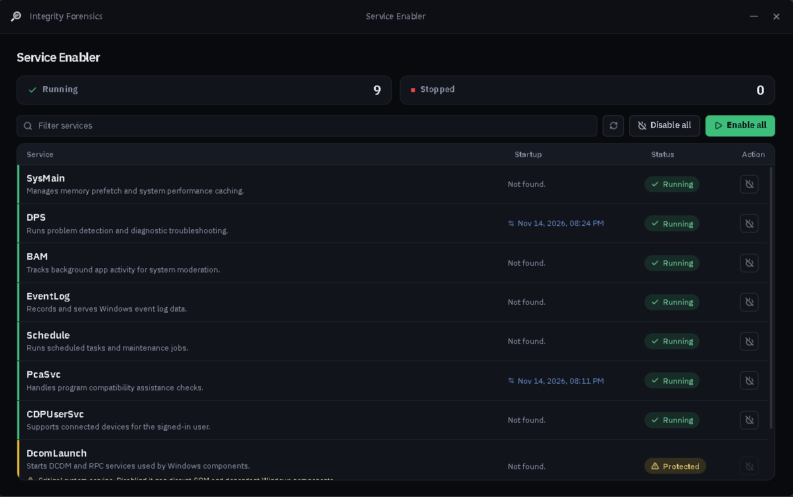

[](https://github.com/Integrity-Forensics/Service-Enabler/releases/latest)

[](https://discord.integrityforensics.net)

# ⚙️ Service Enabler
A simple tool to check and enable all required system services for a screenshare.

Built with **JavaScript**, **Vite**, and **React**, and completely **open-source**. 💚

> [!CAUTION]
> Windows may display a security warning because the application is not currently code-signed.

The code is **far from perfect**, so improvements and pull requests are always welcome! ❤️

---

### ❓ Status
This project is still in early beta and is subject to change at any given time!

> [!WARNING]
> The project is in version **v1.0 BETA** 🟡. Bugs are expected!

---

### 🖥️ Opening a Pull Request
Before opening a pull request, please ensure you follow the guidelines below:

1. Use the following format for your PR:

```md
## Changes Made
Changes here...

## Purpose of Said Changes
Purpose here...
```

2. Follow the code standards of this project.
3. Only add **useful** features or enhancements.

---

### ✅ Supported Services & Platforms

<table>
<tr>
<td valign="top" width="33%">

#### 🛠️ Services (Part 1)

| Service  | Status |
| -------- | :----: |
| SysMain  |   🟢   |
| DPS      |   🟢   |
| BAM      |   🟢   |
| EventLog |   🟢   |
| Schedule |   🟢   |

</td>
<td valign="top" width="33%">

#### 🛠️ Services (Part 2)

| Service      | Status |
| ------------ | :----: |
| PcaSvc       |   🟢   |
| CDPUserSvc_* |   🟢   |
| DcomLaunch   |   🟢   |
| DiagTrack    |   🟢   |

</td>
<td valign="top" width="34%">

#### 🎮 Platforms

| Platform  | Status |
| --------- | :----: |
| Minecraft |   🟢   |
| Roblox    |   🟢   |
| FiveM     |   🟢   |

</td>
</tr>
</table>

---

### 👀 Preview

<div align="center">
  
</div>
